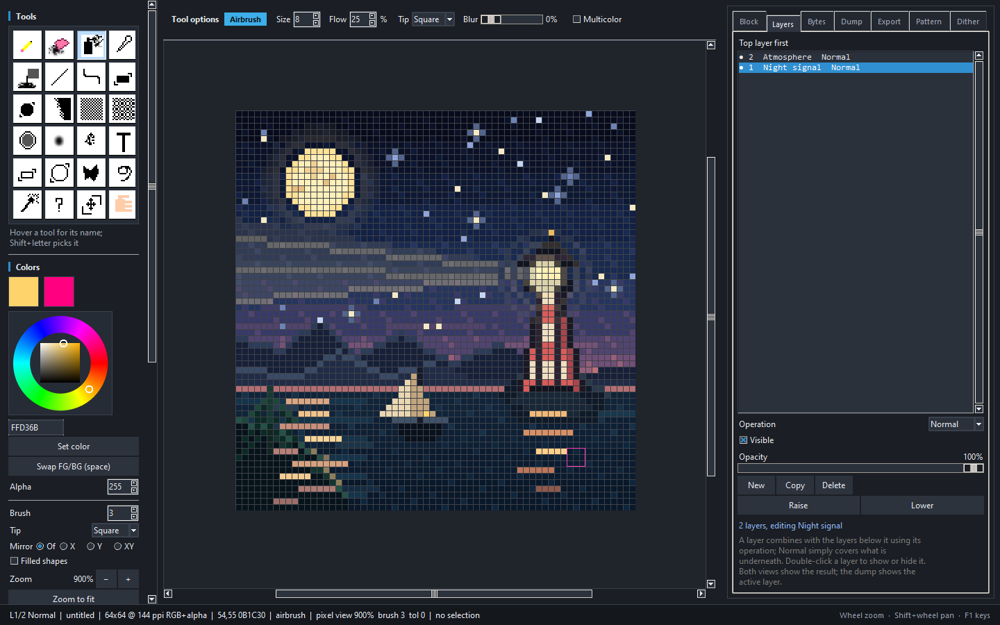
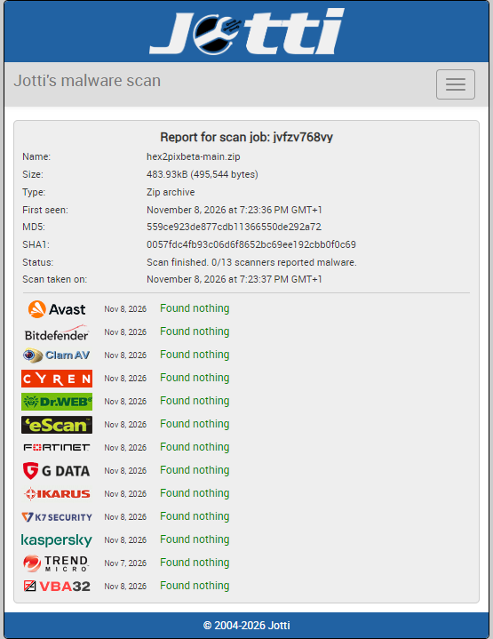
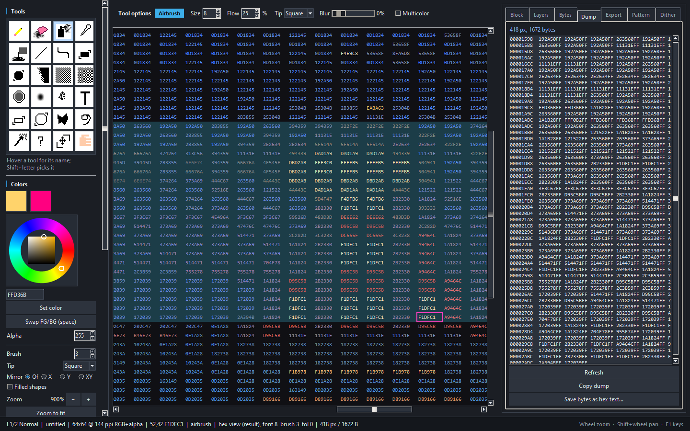
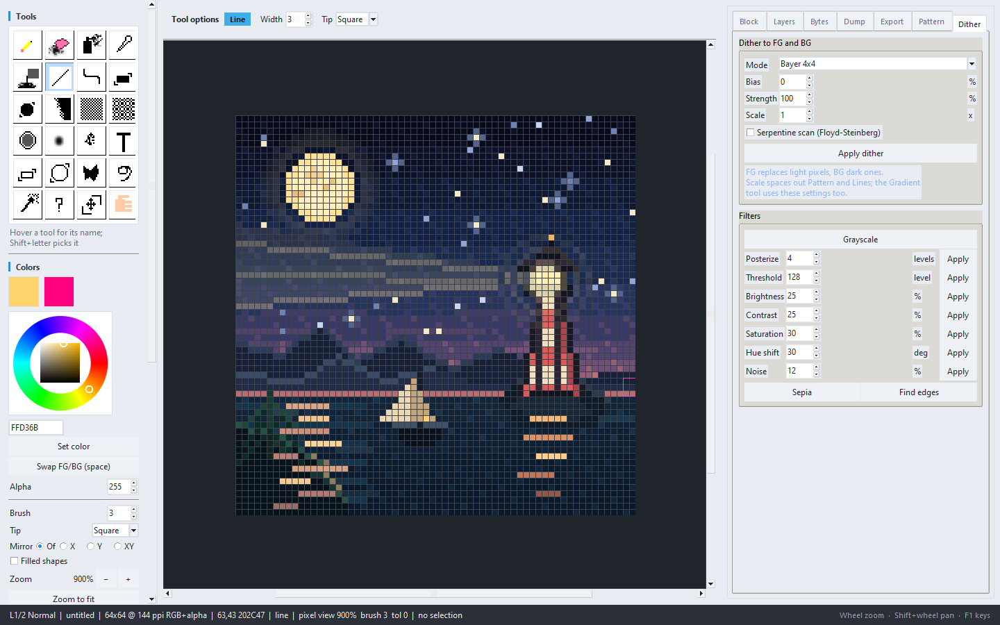

# hex2pix

**A pixel editor where the hex is the tool.**

hex2pix is a standalone pixel-art editor built around hexadecimal pixel data.
Type a color, press `Enter`, and paint the pixel under the keyboard cursor;
paste rows of pixels as text; or select the actual RGBA bytes under the artwork
with rectangle, ellipse, polygon, lasso, wand and similar tools. The same
document can be inspected as a normal image or as a grid of live hex codes.

The mouse is fully supported for drawing, selecting and navigating. The
keyboard is the primary instrument.



## Highlights

- **Type-to-paint workflow** — 3, 4, 6 and 8 digit hex colors, with the pixel
  cursor advancing after each paint.
- **Hex blocks** — paste `FF0000 00FF00 0000FF` into the Block panel and stamp,
  tile or stretch it. `.` skips a pixel, `;` / `|` starts a row and `//` starts
  a comment.
- **Byte selections** — select pixels with art tools, then edit, move, scale,
  rotate, recolor or dump their RGBA bytes.
- **Pixel and hex views** — the canvas can be a rendered image or a grid of
  `RRGGBB` / `RRGGBBAA` codes, both fully editable.
- **A real tool set** — shapes, curves, patterns, airbrush, blur, jumble,
  contour, text, gradients, symmetry and a color wheel.
- **Palettes and dithering** — PICO-8, DB16, Grayscale, a 256-color cube and
  user palettes, plus ordered and error-diffusion dithering.
- **Projects, layers and formats** — layered `.h2p` projects and export to the
  common pixel-art formats.
- **Packaged Windows build** — `hex2pix.exe` needs no Python installation,
  and a portable folder ZIP covers machines whose antivirus blocks the
  single file's temporary unpacking.
- **Optional desktop extras** — automatic update checks in the packaged
  Windows build.

## Example artwork

This 64×64 scene, *Night Signal*, was made as a two-layer hex2pix document
(`Night signal` + `Atmosphere`) and is included in the screenshots below.

<p align="center">
  
</p>

## Quick start

Download the latest release from the
[Releases page](https://github.com/Shagg097/hex2pixbeta/releases) — either
`hex2pix.exe` (single file) or `hex2pix-portable.zip` (folder build) — or build
it yourself, then run it:

```text
hex2pix.exe                 # start page: presets and recent documents
hex2pix.exe art.bmp         # open an image in the editor
```

### If the packaged executable does not start

`hex2pix.exe` is a single-file build: on every start it unpacks its Python
runtime into `%TEMP%\_MEIxxxxxx` and loads `python310.dll` from there. Some
antivirus products quarantine or block that freshly written DLL, which appears
as

```text
Failed to load Python DLL
C:\Users\<you>\AppData\Local\Temp\_MEIxxxxxx\python310.dll
```

Use `hex2pix-portable.zip` from the same release instead. Unzip it anywhere you
can write and run `hex2pix.exe` inside the folder: that build keeps its runtime
DLLs on disk beside the executable and never extracts to `%TEMP%`. If you want
to keep using the single file, adding an antivirus exclusion for it clears the
same error.

To run from source:

```bash
py -3 run_hex2pix.py
```

Requirements: **Python 3.10+**, **tkinter** and **Pillow**. Tkinter is included
with the standard Windows Python installer. On Linux, install the distribution's
`python3-tk` package.

The packaged executable is built for Windows. Build instructions are
[below](#build-the-executable).

## Virus scan

The `hex2pixbeta-main.zip` source archive was scanned by Jotti's malware
scan: **0 of 13 engines reported malware**
([full report](https://virusscan.jotti.org/en-US/filescanjob/jvfzv768vy)).

<p align="center">
  <a href="https://virusscan.jotti.org/en-US/filescanjob/jvfzv768vy"></a>
</p>

## The hex idea

### Paint by typing

Digits `0-9` and `A-F` fill the hex buffer shown in the status bar. Press
`Enter` to apply that color to the foreground and paint the pixel at the cursor.
The cursor then moves one pixel right, ready for the next value.

Accepted forms include:

```text
F00        -> FF0000
F008       -> FF000088
FF0000     -> opaque red
FF000080   -> half-transparent red
```

Arrow keys move the pixel cursor; `Ctrl`+arrows move it eight pixels. Delete
erases the pixel under the cursor, or every pixel inside the selection. Escape
cancels whatever is in progress and then deselects. The canvas is a first-class
keyboard editor, not a mouse-only surface with shortcuts bolted on.

### Paint with hex blocks

The **Block** panel treats pixel rows as text:

```text
FF0000 00FF00 0000FF
00FFFF . FFFF00      // '.' leaves this pixel untouched
```

Use **Stamp**, **Tile** or **Stretch**, then apply scale, rotation, flips and
mirroring. **Load from selection** and **Copy block** move artwork between the
canvas and text, and `Ctrl+C` / `Ctrl+V` use the same block format.

### Inspect the bytes

The **Dump** panel lists the selected pixels as offset / `RRGGBBAA` rows, with
pixel and byte counts. **Copy dump** copies the text, and the same selection can
be saved as hex text.

## Byte selections

A selection in hex2pix is a byte mask: one byte per pixel deciding whether that
pixel's four RGBA bytes participate in the next edit.

| Tool | Selection |
| --- | --- |
| Rectangle | drag a box |
| Ellipse | drag a box, filled with the inscribed ellipse |
| Polygon | click vertices; `Enter` or double-click closes; `Shift+Enter` adds a vertex |
| Lasso | freehand path, closed and tidied on release |
| Wand | contiguous matching pixel data |
| Similar | all matching pixels in the image |

Hold `Shift` to add, `Ctrl` to subtract and `Alt` to intersect. A right-drag
with a selection tool subtracts. Tolerance lives in the left panel; `0` means
an exact byte match.

**Move / Scale** turns a selection into a floating piece. Drag inside it to
move, `Shift`+drag to scale from the opposite corner, or `Ctrl`+drag to rotate
in 15° steps. Press `Enter` to drop it at the cursor and `Escape` to put it
back. The selection follows the pixels, and the whole operation is one undo
step.

Polygon and lasso paths are filled solid, including enclosed pockets, so a
self-crossing outline cannot leave holes in the mask.

## Tools

### Painting and shapes

| Tool | What it does |
| --- | --- |
| Pencil / Eraser | Paint or erase with a square or circular tip, 1–64 px |
| Airbrush | Spray foreground pixels inside the brush footprint; **Flow**, feathered **Blur** and **Multicolor** |
| Fill | Flood fill with adjustable tolerance |
| Picker | Pick a color into the foreground or background |
| Line | Drag a straight line; `Shift` snaps to 0°, 45° or 90° |
| Curve | Bend a line by a percentage, split it into 1–8 arcs and choose left, right or alternating sides |
| Rectangle / Ellipse | Outline or filled shapes; `Shift` constrains to a square or circle |
| Gradient | Interpolate foreground to background, with optional dithering |
| Contour | Draw an inside or outside ring around a selection or opaque artwork |
| Blur | Soften with a 3×3 neighborhood; strength controls the mix |
| Jumble | Shuffle, scatter or add channel noise under the brush |
| Text | Stamp text in a built-in 5×7 font with scale and spacing |
| Line pattern | Fill selected lines with consecutive pattern rows; `Shift` staggers them |
| Structure fill | Build mirrored super-tiles from the pattern and repeat them over a selection |

Brush size, tip shape and mirroring are shared across the painting tools.
Mirroring can work across the X axis, Y axis, or both. Shapes and brush strokes
preview live while dragging.

### Patterns and fills

The **Pattern** tab is a micro pixel canvas. Click a cell to paint it in the
foreground color, right-click or `Ctrl`+click to skip it. It can also be typed
as hex rows and converted both ways.

- **Line pattern** gives each line the next pattern row, perfect for stripes,
  scanlines and repeating texture.
- **Structure fill** makes a super-tile from mirrored copies of the pattern and
  repeats it, producing kaleidoscope-like fills and ornamental backgrounds.

Patterns share their scale, shift and mirror settings with the fill controls.
`Enter` applies the active fill at the keyboard cursor, so pattern work does
not require the mouse.

### Dithering and filters

The **Dither** tab reduces a selection or the active layer to the foreground and
background colors:

| Mode | Result |
| --- | --- |
| Bayer 2×2 / 4×4 / 8×8 | Stable ordered dot patterns |
| Floyd–Steinberg | Organic error diffusion, with an optional serpentine scan |
| Pattern | Uses the Pattern tab as the dither matrix |
| Noise | White-noise threshold, useful for grain |
| Lines | Horizontal scanline bands, scaled by row count |

Bias moves the light/dark cutoff, Strength blends the result toward the
original pixels, and Scale spaces out Pattern and Lines. The Gradient tool can
use the same settings.

The filters are **Grayscale**, **Posterize**, **Threshold**, **Brightness**,
**Contrast**, **Saturation**, **Hue shift**, **Noise**, **Sepia** and **Find
edges**. Each is one undo step.

## Palettes and color

The left rail includes a scrolling swatch grid and a color wheel:

- Presets: **PICO-8**, **DB16**, **Grayscale** and the 256-color **256 Cube**.
- Left-click a swatch to use it, right-click to edit it.
- **New…** creates a palette with 1–256 slots.
- Save/load `.256` hex lists, GIMP `.gpl` and JASC `.pal`.
- **Map to palette** and **Map + dither** recolor a layer or selection.
- **+ FG**, **Set** and **Del** refine the active palette.

The wheel edits the foreground with the left button and the background with the
right button. The hex and alpha fields update with the wheel, and GIF export
writes an adaptive 256-color palette.

## Views and camera

Open a document in **pixel view** to see the rendered artwork on a checkerboard
with a pixel grid and selection overlays. Switch to **hex view** with
`View > Hex code view`, the **Pixel / Hex** radios, or the `H` key.



In hex view every visible cell is drawn as its own code:

- Opaque pixels read `RRGGBB`.
- Partly transparent pixels read `RRGGBBAA`.
- Fully transparent pixels read `......`.
- Selected cells get a tint.
- Very dark codes are lightened just enough to stay legible.

Only visible cells are drawn, so large canvases stay responsive. Tools,
selections and the cursor behave the same in both views.

Mouse and camera controls:

- Wheel zooms around the pointer; `[` / `]` zoom out and in.
- **Shift**+wheel pans sideways.
- **Ctrl**+wheel changes brush size in pixel view (or hex font size in hex view).
- Middle-drag or **Hand** pans freely, including beyond the canvas edge.
- Double-click the middle button or double-click with **Hand** to zoom to fit.
- `F11` toggles borderless fullscreen; `Escape` leaves it and restores the
  previous window geometry.

## Layers

The **Layers** tab stacks bitmaps that share a canvas and selection. Each layer
has an operation and an opacity:

| Operation | Result |
| --- | --- |
| Normal | Covers the layers below |
| Add | `below + above`, clamped |
| Subtract | `below - above`, clamped |
| Multiply | `below * above / 255` |
| Divide | `below * 255 / above` |

A pixel's alpha is the strength of the operation, so transparent pixels leave
the stack alone. The **Opacity** slider blends the active layer without changing
its stored pixels. New layers start as **Normal**, so drawing covers instead of
combining.

Both views show the flattened result. The Dump tab, byte tools and Copy block
work on the active layer. **New**, **Copy**, **Delete**, **Raise** and **Lower**
manage the stack. `Ctrl+Shift+N` adds a layer; drag a row to restack it,
double-click to hide or show it, and `Alt+Up` / `Alt+Down` restack the active
layer.

## Canvas and documents

**File > New canvas…** opens a canvas dialog with:

- Presets from 16×16 icons up to 1920×1080.
- Width and height in **px**, **mm** or **in**, with a keep-ratio lock.
- Resolution in **ppi**, with a live physical-size readout.
- **RGB** or **Grayscale** at 8-bit integer precision.
- An optional alpha channel.
- A transparent, white, black, foreground or background fill.

**Image > Canvas properties…** edits the same settings on an open image. When
the pixel size changes, choose:

- **Pad/crop** — preserve every pixel and add or remove canvas around it using
  a nine-way anchor.
- **Resample** — scale with nearest-neighbor or premultiplied bilinear
  filtering, so transparent edges do not pick up dark fringes.

Resolution is metadata, not pixels. It drives the mm/in readout and is written
to PNG, TIFF, JPEG, WEBP and BMP, then restored when the file is reopened. A
canvas change is one undo step; undo restores size, resolution, color model,
alpha and pixels together.

## Projects and file formats

**File > Save project as…** writes a `.h2p` file: a zip containing a
`project.json` header, one raw RGBA entry per layer and the selection mask.
Reopening it restores the layer stack, names, order, visibility, opacity,
operations, canvas settings, active layer, palette, pattern, mirror setting,
foreground/background colors and current view.

**File > Open…** recognizes `.h2p` automatically. Once a document is a `.h2p`,
`Ctrl+S` saves the project instead of flattening it to an image.

Reading goes through Pillow: PNG, BMP, GIF, TGA, ICO, TIFF, WEBP, JPEG and PPM.
`.txt` / `.hex` files open as hex blocks.

| Write format | Alpha | Notes |
| --- | --- | --- |
| PNG | Yes | 8-bit RGBA |
| BMP 24-bit | No | Hand-written header; transparency blended onto a matte |
| BMP 32-bit | Yes | Hand-written; alpha preserved |
| TGA | Yes | 32-bit |
| GIF | No | Adaptive 256-color palette |
| ICO | Yes | Padded to a square entry, never resampled |
| TIFF | Yes | RGBA |
| WEBP | Yes | Lossless |
| JPEG | No | Flattened, adjustable quality |
| PPM | No | Binary `P6` |
| Hex text | n/a | `RRGGBBAA` rows; `.` for transparent |

BMP and PPM are written by hand rather than through Pillow, so the 24-bit BMP
really is 24 bits per pixel and the loader can reopen hex2pix output with its
alpha intact.

## Start page and recent documents

Opening hex2pix without a file argument shows a start page with the wordmark, a
grid of preset canvases, **Custom canvas…**, **Open image…** and a **Recent
documents** list. Double-click a recent entry or press `Enter` to reopen it;
entries whose files have disappeared drop out. The recent list lives in
`%APPDATA%\hex2pix\recent.json`.

**File > Home** returns to the page at any time, and **Continue** goes back to
the editor. Passing a filename on the command line skips the start page.

## Automatic updates

The update check is optional; the editor still works offline without it.

Packaged Windows builds check the repository's GitHub Releases shortly after
launch. **Help > Check for updates...** checks on demand. When a newer build
exists, hex2pix asks before downloading it, verifies the asset size and the
SHA-256 digest published by GitHub, then closes, replaces `hex2pix.exe` and
restarts.

- **Check for updates automatically** in the Help menu controls the startup
  check.
- Stable builds skip prereleases; prerelease builds may be offered
  prereleases.
- The updater needs write access beside the executable. Portable folders work;
  protected locations such as `Program Files` do not.
- Source checkouts never replace themselves; a manual check offers the release
  page instead.
- To publish an update, push a version tag such as `v1.3.0b1`; the release
  workflow builds `hex2pix.exe` and attaches it as that release's executable.
  Releases without the asset are ignored.

The update check contacts only `api.github.com` and sends no usage telemetry.

## Keyboard macros

`F9` records editor keystrokes: cursor moves, hex digits, `Enter`, Delete,
brush and zoom keys, tool shortcuts, `Escape` and `Ctrl+Z/Y/A/D`. Keys that
open dialogs are never recorded, so playback cannot unexpectedly open a file
dialog.

`F5` plays the recording back at about 20 keys per second through the same
handler a person uses. **Macro > Play repeatedly…** repeats it; `Escape` stops
playback and physically pressed keys are ignored while it runs. Recordings can
be saved and loaded as JSON.

## Dark and light themes

The editor starts in dark mode. **View > Dark mode** switches the entire window
— menus, dockers, tool cards, fields, text panels, the color wheel and the start
page — to the light palette and back.



The same View menu ends with one checkbutton per right-side docker
(**Block**, **Layers**, **Bytes**, **Dump**, **Export**, **Pattern**,
**Dither**), so any tab can be hidden and restored without losing its contents
or tab order. The left tool rail scrolls independently when the window is short,
and the tool-options bar scrolls horizontally when the active tool has more
controls than fit.

## Panel and shortcut reference

| Area | Purpose |
| --- | --- |
| Left rail | Tools, color wheel, foreground/background, alpha, brush size, tip, mirror, palette, macros, selection info |
| Tool options | Controls for the active tool, from brush settings to selection mode |
| Canvas | Pixel or hex editing surface |
| Right dockers | Block placement, layers, byte operations, dump, export, pattern, dither and filters |
| Status bar | Canvas size, resolution, color mode, cursor, tool, view, brush, selection and mode hints |

| Shortcut | Action |
| --- | --- |
| Arrows | Move the pixel cursor |
| `0-9 A-F` | Type a hex color |
| `Enter` | Apply color and paint, close a polygon, set a selection corner, or run a fill/shape tool |
| `Backspace` | Delete a typed hex digit |
| `G` | Pick the color under the cursor |
| `Delete` | Erase the pixel under the cursor, or the pixels inside the selection |
| `+` / `-` | Change brush size |
| `[` / `]` | Zoom out / in |
| `Space` | Swap foreground and background |
| `Shift` + letter | Pick a tool (letters are on Shift so `A–F` stay available for hex) |
| `Shift+T` | Move / Scale tool |
| `Ctrl+Z` / `Ctrl+Y` | Undo / redo |
| `Ctrl+A` / `Ctrl+D` | Select all / deselect |
| `Ctrl+C` / `Ctrl+V` | Copy / paste hex block text |
| `Ctrl+O` / `Ctrl+S` | Open / save |
| `Ctrl+E` | Jump to the Export tab |
| `Ctrl+Shift+N` | New layer |
| `Alt+Up` / `Alt+Down` | Raise / lower the active layer |
| `F5` / `F9` | Play / record a macro |
| `F11` / `Escape` | Toggle fullscreen / leave it; `Escape` also deselects |
| `F1` | Keyboard reference |

A tool's exact shortcut and a one-line reminder appear when hovering its tile.
The in-app **Manual** link opens the complete [hex2pix manual](hex2pix/README.md).

## Build the executable

From the repository root:

```bash
build_exe.cmd
```

Or run PyInstaller directly:

```bash
py -3 -m PyInstaller --noconfirm --clean --onefile --windowed --name hex2pix \
    --paths . --hidden-import PIL._tkinter_finder \
    --add-data "hex2pix\README.md;hex2pix" run_hex2pix.py
```

The result is `dist\hex2pix.exe`: one self-contained file with no Python
installation required on the target machine.

## Tests

```bash
py -3 -m unittest discover -s hex2pix/tests -t .
py -3 run_hex2pix.py --selftest
```

The first command runs **350 unit tests** covering the model, canvas geometry,
formats, colors, palettes, patterns, dithering, effects, filters, macros,
projects and update checks. The second adds a headless GUI pass that builds the
window and exercises painting, erasing, selections, canvas resizing, undo,
home/recent
navigation, pattern fills, fullscreen, dark/light themes, docker toggles and the
shape/mouse helpers. It writes `hex2pix-selftest.txt`.

The frozen build supports the same check:

```bash
dist\hex2pix.exe --selftest
```

## Repository layout

```text
hex2pixmain/
├─ run_hex2pix.py          entry point and PyInstaller script
├─ build_exe.cmd           Windows build helper
├─ hex2pix/
│  ├─ app.py               Tk window, panels and interaction
│  ├─ model.py             bitmaps, documents, selections and edits
│  ├─ canvas.py            canvas specs, resize and resampling
│  ├─ formats.py           image/project readers and writers
│  ├─ effects.py           airbrush, blur, jumble and text
│  ├─ shapes.py            lines, rectangles, ellipses and curves
│  ├─ dither.py            ordered and error-diffusion dithering
│  ├─ filters.py           image filters
│  ├─ pattern.py           line/structure pattern fills
│  ├─ palette.py           palette presets and file formats
│  ├─ macro.py             keystroke recording and playback
│  ├─ integrations.py      GitHub release update checks
│  ├─ bitmapfont.py        built-in 5×7 text font
│  ├─ assets/             16×16 BMP tool icons
│  └─ tests/              350 unit tests
└─ docs/                   README screenshots and example artwork
```

## Limits

- Layers share one selection and canvas size; the stack is flat, with no groups
  or per-layer offsets.
- Undo keeps whole-image snapshots under a 96 MB budget (roughly 90 steps for a
  512×512 image, fewer for larger canvases).
- Selections are hard-edged byte masks; there is no feathering or
  anti-aliasing.
- Brush tips are square or circle; there are no custom brush stamps.
- Canvases are capped at 8192 pixels per side.
- Automatic updates require the packaged Windows build and write access beside
  the executable; source checkouts open the release page instead.

---

hex2pix is designed for sprites, icons, tilesets, texture work and anyone who
likes seeing the bytes behind the art.
