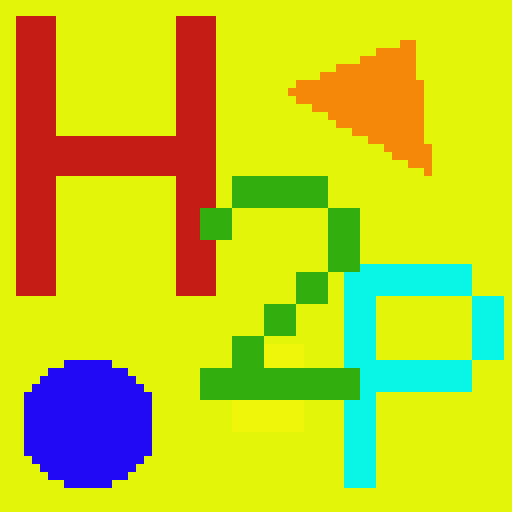
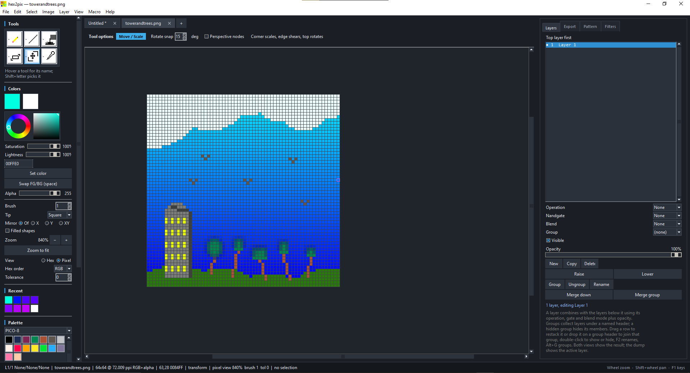

<p align="center">
  
</p>

# hex2pix

**A pixel editor where the hex is the tool.**

hex2pix is a standalone pixel-art editor built around hexadecimal pixel data.
Type a color, press `Enter`, and paint the pixel under the keyboard cursor;
paste rows of pixels as text; or select the actual RGBA bytes under the artwork
with rectangle, ellipse, polygon, lasso, wand and similar tools. The same
document can be inspected as a normal image or as a grid of live hex codes.

The mouse is fully supported for drawing, selecting and navigating. The
keyboard is the primary instrument.

> **Windows 7 compatibility branch.** This branch, `win7-compat`, keeps the
> editor identical to `main` but freezes it against **CPython 3.8.20**, the last
> CPython release with Windows 7 support, so the packaged executable runs on
> Windows 7 SP1 and newer through WoW64 as well. `main` remains the 3.10 release
> line. See
> [Windows 7 compatibility](#windows-7-compatibility).



## Highlights

- **Type-to-paint workflow** — 3, 4, 6 and 8 digit hex colors, with the pixel
  cursor advancing after each paint.
- **Hex blocks** — paste `FF0000 00FF00 0000FF` into the Block panel and stamp,
  tile or stretch it. `.` skips a pixel, `;` / `|` starts a row and `//` starts
  a comment.
- **Byte selections** — select pixels with art tools, then edit, move, scale,
  rotate, recolor or dump their RGBA bytes.
- **Pixel and hex views** — the canvas can be a rendered image or a grid of
  `RRGGBB` / `RRGGBBAA` codes, both fully editable.
- **A real tool set** — shapes, curves, patterns, spray can, blur, shuffle,
  contour, text, gradients, symmetry and a color wheel.
- **Palettes and dithering** — PICO-8, DB16, Grayscale, a 256-color cube and
  user palettes, plus ordered and error-diffusion dithering.
- **Projects, layers and formats** — layered `.h2p` projects plus an Export
  docker that saves the project and writes images with scale, trim, matte,
  resolution and per-format options.
- **Packaged Windows build** — `hex2pix.exe` needs no Python installation,
  and a portable folder ZIP covers machines whose antivirus blocks the
  single file's temporary unpacking.
- **Optional desktop extras** — automatic update checks in the packaged
  Windows build.

## Install on Windows

**You do not need Python, pip or any other runtime installed.** The release
executable is a self-contained Windows program: PyInstaller bundles CPython
3.8.20 (32-bit), Tcl/Tk and Pillow together with the hex2pix code, so it runs on a
machine that has never had Python on it. There is no installer and nothing to
add to `PATH` — it is an ordinary windowed `.exe`.

Download from the
[Releases page](https://github.com/Shagg097/hex2pixbeta/releases):

| File | Size | Use it when |
| --- | --- | --- |
| `hex2pix.exe` | ~18 MB | the usual choice: one file, no console window |
| `hex2pix-portable.zip` | ~18 MB | antivirus blocks the single file (see below) |
| [Windows 7 release](https://github.com/Shagg097/hex2pixbeta/releases/tag/win7-compat) | ~11 MB | Windows 7 SP1 and newer: the 32-bit CPython 3.8.20 `hex2pix.exe`, which also runs on 64-bit Windows (see [below](#windows-7-compatibility)); the same release also carries `hex2pix-portable.zip` |

Put the executable (or the unzipped folder) anywhere you can write — Desktop,
`D:\Tools`, a USB stick — and double-click it. No administrator rights are
needed.

- **Requirements:** Windows 7 SP1 or newer, 32-bit or 64-bit. This branch ships a 32-bit executable.
- **First start takes a few seconds:** the single file unpacks its bundled
  runtime into `%TEMP%\_MEIxxxxxx` on each start and removes it on exit.
- **SmartScreen:** the download is not code-signed, so Windows may show
  "Windows protected your PC". Choose **More info** → **Run anyway**.
- **No console window:** the executable is built as a GUI program, so no
  terminal opens beside the editor.

Python is only needed to run or build from source; see
[Run from source](#run-from-source) and
[Build the executable](#build-the-executable).

## Windows 7 compatibility

`main` freezes CPython 3.10, and CPython has required Windows 8.1 or newer from
3.10 onward (3.12 and newer need Windows 10). This branch freezes **CPython
3.8.20** instead, the last CPython release that supports Windows 7, so the same
editor starts on Windows 7 SP1 and on every later Windows, 32-bit or 64-bit.

The Python source is unchanged: everything under `hex2pix/` is identical to
`main`, because it already runs on 3.8. Only the frozen toolchain differs, so the
executable carries the 32-bit `python38.dll` and Tcl/Tk 8.6 rather than
`python310.dll`. The runtime is R-YaTian's [Windows XP build of CPython
3.8.20](https://github.com/R-YaTian/CPython3.8.20WinXP), whose interpreter and
DLL declare a Windows 5.1 subsystem.

PyInstaller 6's bootloader still declares a Windows 6.0 subsystem, so these
executables start on Windows Vista/7 and newer, not on XP. The
[`retro-compat` branch](https://github.com/Shagg097/hex2pixbeta/tree/retro-compat)
fills that gap with cx_Freeze, whose launcher declares 5.1.

Verified on this branch with CPython 3.8.20 (32-bit, Tcl/Tk 8.6, MSC v.1916):

| Check | Result |
| --- | --- |
| `python -m unittest discover -s hex2pix/tests -t .` | 551 tests, 0 failures, 0 errors |
| `python run_hex2pix.py --selftest` | `RESULT: PASS`, every GUI check true |
| `packaging/hex2pix.spec` to `dist\hex2pix.exe` | built, `--selftest` gives `RESULT: PASS` |
| `packaging/hex2pix_onedir.spec` to `dist\hex2pix-portable\` | built, `--selftest` gives `RESULT: PASS` |
| Interpreter inside both builds | 32-bit `python38.dll`, no `python310.dll` |
| PE header of both executables | 32-bit (`0x14C`), subsystem 6.0 |

### Building it

Python 3.8.11 and later were security-only releases, so python.org publishes no
Windows installer for 3.8.20. This branch uses the 32-bit Windows XP build from
[R-YaTian/CPython3.8.20WinXP](https://github.com/R-YaTian/CPython3.8.20WinXP),
which includes Tcl/Tk. It is a WiX Burn installer, so it can install quietly
into the checkout without touching PATH, shortcuts or the launcher:

```bat
curl -L -o py38xp.exe "https://github.com/R-YaTian/CPython3.8.20WinXP/releases/download/v3.8.20_final/python-3.8.20-full.exe"
py38xp.exe /quiet InstallAllUsers=0 TargetDir="%CD%\python38-32" Include_doc=0 Include_test=0 Include_launcher=0 Include_pip=1 Include_tcltk=1 PrependPath=0 Shortcuts=0 AssociateFiles=0
del py38xp.exe
python38-32\python.exe -c "import tkinter; print('tkinter ok')"
```

Then install the pinned requirements into it and call the specs directly, because
`packaging\build_exe.cmd` builds with whichever interpreter `py -3` resolves to:

```bat
python38-32\python.exe -m pip install -r requirements.txt
python38-32\python.exe -m PyInstaller --noconfirm --clean --distpath dist --workpath build packaging\hex2pix.spec
python38-32\python.exe -m PyInstaller --noconfirm --clean --distpath dist --workpath build packaging\hex2pix_onedir.spec
```

### What this branch costs

- **Both Windows 7 and the frozen interpreter are out of support.** CPython 3.8
  reached end of life on 7 October 2024, so no security fix after that date can
  reach the interpreter inside the executable. Treat this as a compatibility line
  for machines that cannot move, not as the recommended download.
- **Dependency ceiling.** Pillow 10.4.0 is the last release that supports 3.8, and
  `requirements.txt` pins the exact Pillow and PyInstaller versions verified here,
  so newer library features will not arrive on this branch.
- **Distribution.** Version tags on `main` build the 3.10 executable through
  `.github/workflows/release.yml`; this branch is checked by
  `.github/workflows/win7-build.yml` instead, which publishes this build in the
  [Windows 7 release](https://github.com/Shagg097/hex2pixbeta/releases/tag/win7-compat)
  and keeps each run's files as an `hex2pix-py38-win7-x86` artifact for 90 days.
- **Windows XP is out of reach here.** PyInstaller's bootloader needs Windows
  Vista/7 or newer. The `retro-compat` branch carries the same 32-bit CPython
  runtime but freezes it with cx_Freeze, whose launcher targets XP.

## Quick start

```text
hex2pix.exe                 # start page: presets and recent documents
hex2pix.exe art.bmp         # open an image in the editor
```

### If the packaged executable does not start

`hex2pix.exe` is a single-file build: on every start it unpacks its Python
runtime into `%TEMP%\_MEIxxxxxx` and loads `python38.dll` from there. Some
antivirus products quarantine or block that freshly written DLL, which appears
as

```text
Failed to load Python DLL
C:\Users\<you>\AppData\Local\Temp\_MEIxxxxxx\python38.dll
```

Use `hex2pix-portable.zip` from the same release instead. Unzip it anywhere you
can write and run `hex2pix.exe` inside the folder: that build keeps its runtime
DLLs on disk beside the executable and never extracts to `%TEMP%`. If you want
to keep using the single file, adding an antivirus exclusion for it clears the
same error.

### Run from source

Only this path needs Python installed:

```bash
py -3 run_hex2pix.py
```

Requirements: **Python 3.8.20** on this branch, **tkinter** and **Pillow**. Tkinter is included
with the standard Windows Python installer. On Linux, install the distribution's
`python3-tk` package.

The packaged executable is built for Windows. Build instructions are
[below](#build-the-executable).

## Virus scan

VirusTotal's URL report for the project page at
`https://github.com/Shagg097/hex2pixbeta` reports **no security vendors
flagged it as malicious** ([full report](https://www.virustotal.com/gui/url/6455f0b48e41bf69bc1ee2070d13780ff75483edb85d802520ce373ec3efc4e2),
scanned 9 November 2026). The check covers the repository page, not the
contents of the executable.

## The hex idea

### Paint by typing

Digits `0-9` and `A-F` fill the hex buffer shown in the status bar. Press
`Enter` to apply that color to the foreground and paint the pixel at the cursor.
The cursor then moves one pixel right, ready for the next value.

Accepted forms include:

```text
F00        -> FF0000
F008       -> FF000088
FF0000     -> opaque red
FF000080   -> half-transparent red
```

Arrow keys move the pixel cursor; `Ctrl`+arrows move it eight pixels. Delete
erases the pixel under the cursor, or every pixel inside the selection. Escape
cancels whatever is in progress and then deselects. The canvas is a first-class
keyboard editor, not a mouse-only surface with shortcuts bolted on.

### Paint with hex blocks

The **Block** panel treats pixel rows as text:

```text
FF0000 00FF00 0000FF
00FFFF . FFFF00      // '.' leaves this pixel untouched
```

Use **Stamp**, **Tile** or **Stretch**, then apply scale, rotation, flips and
mirroring. **Load from selection** and **Copy block** move artwork between the
canvas and text, and `Ctrl+C` / `Ctrl+V` use the same block format.

### Inspect the bytes

The **Dump** panel lists the selected pixels as offset / `RRGGBBAA` rows, with
pixel and byte counts. **Copy dump** copies the text, and the same selection can
be saved as hex text.

## Byte selections

A selection in hex2pix is a byte mask: one byte per pixel deciding whether that
pixel's four RGBA bytes participate in the next edit.

| Tool | Selection |
| --- | --- |
| Rectangle | drag a box |
| Ellipse | drag a box, filled with the inscribed ellipse |
| Polygon | click vertices; `Enter` or double-click closes; `Shift+Enter` adds a vertex |
| Lasso | freehand path, closed and tidied on release |
| Wand | contiguous matching pixel data |
| Similar | all matching pixels in the image |

Hold `Shift` to add, `Ctrl` to subtract and `Alt` to intersect. A right-drag
that starts outside the selection subtracts; `Ctrl`+drag subtracts anywhere.
Right-click inside a selection for Delete, Split to new layer, Copy to new
layer, Copy to clipboard and Copy to pattern. Tolerance lives in the left
panel; `0` means an exact byte match.

**Move / Scale** turns a selection into a floating piece. Drag inside it to
move, `Shift`+drag to scale from the opposite corner, or `Ctrl`+drag to rotate
rotate. Rotation uses **CleanEdge** by default: each destination pixel takes
its colour from cleanEdge's quadrant slices, so a turned outline is redrawn
as a clean line instead of breaking into dashes. The **Algorithm** menu also
offers RotSprite, Nearest and Transpose 90, and **Smooth edges** is a separate
toggle that blends the rotated edges instead.
Scaling keeps the piece's proportions and holds the opposite
corner still, so a drag can neither squash the artwork nor flip it, and
rotation only starts once the pointer leaves the middle, so grabbing the
centre cannot spin the piece wildly. Press `Enter` to drop it at the cursor
and `Escape` to put it back. The selection follows the pixels, and the whole
operation is one undo step.

Polygon and lasso paths are filled solid, including enclosed pockets, so a
self-crossing outline cannot leave holes in the mask.

## Tools

The tool palette is a grid of dropdown folders, grouped by what the tools do:
**Brush**, **Shapes**, **Fill**, **Select**, **Transform**, and **Text and
pick**. Click a folder to open its tools; the button shows the tool you last
used from that folder, and hovering it lists what is inside.

### Painting and shapes

| Tool | What it does |
| --- | --- |
| Pencil / Eraser | Paint or erase with a square, circular or custom tip, 1–64 px; Pencil can stamp the pattern as its tip |
| Spray can | Spray foreground pixels inside the brush footprint; **Flow**, feathered **Blur** and **Multicolor** |
| Fill | Flood fill with adjustable tolerance |
| Picker | Pick a color into the foreground or background |
| Line | Drag a straight line; `Shift` snaps to 0°, 45° or 90°; **Background** paints in the BG color |
| Curve | Bend a line by a percentage, split it into 1–8 arcs and choose left, right or alternating sides; **Background** paints in the BG color |
| Rectangle / Ellipse / Triangle / Diamond / Star / Arrow | Outline or filled preset shapes; `Shift` constrains to a square or circle, and **Background** paints with the BG color so the shape cuts into the artwork |
| Gradient | Interpolate foreground to background (linear or radial), or step through the whole palette; Spread clamps, repeats or reflects; optional dithering |
| Contour | Draw an inside or outside ring around a selection or opaque artwork |
| Blur | Soften with an adjustable neighborhood from 1×1 to 17×17; Amount sets its radius, strength controls the mix, smear drags colour along the stroke, and the tip picks the footprint |
| Shuffle | Mix, scatter or add channel noise under the brush; blur softens the mixed result, and the tip picks the footprint |
| Text | Stamp the built-in 5×7 font or any installed OS font; load TTF/OTF/TTC/FON/Type 1/BDF/PCF files, with size and bold/italic |
| Line pattern | Fill selected lines with consecutive pattern rows; `Shift` staggers them |
| Structure fill | Build mirrored super-tiles from the pattern and repeat them over a selection |

The **Text** tool reads the font folders installed on the machine (including
per-user Windows fonts and the font registry) the first time it is opened. The
font menu lists every family that Pillow/FreeType can load; **Load...** adds a
specific TTF, OTF, TTC, FON, Type 1, BDF or PCF file. System fonts use Size and
Bold/Italic, while the built-in 5×7 font keeps Scale and Spacing. Text is
rasterized to hard-edged document pixels, so it remains editable by the hex and
byte tools.

Brush size, tip shape and mirroring are shared across the painting tools,
Blur and Shuffle included. The tip is **Square**, **Circle** or **Custom**:
**Edit…** opens a 9×9 grid where clicking cells shapes your own footprint,
which then scales to the tool's Size, and it is remembered between sessions.
**Pattern tip** on the Pencil stamps the Pattern tab's grid as the brush, in
the pattern's own colours, so a drag paints the tile itself.
Mirroring can work across the X axis, Y axis, or both. Shapes and brush strokes
preview live while dragging.

Shapes and the rectangle, ellipse, polygon and lasso selections are not
stopped by the canvas edge. Drag past it and the drag keeps its true geometry,
so a line keeps its angle and an ellipse dragged from off-canvas keeps its
curvature instead of being squashed against the border; only the pixels inside
the canvas are painted or selected.

### Patterns and fills

The **Pattern** tab is a micro pixel canvas. Click a cell to paint it in the
foreground color, right-click or `Ctrl`+click to skip it. It can also be typed
as hex rows and converted both ways.

- **Line pattern** gives each line the next pattern row, perfect for stripes,
  scanlines and repeating texture.
- **Structure fill** makes a super-tile from mirrored copies of the pattern and
  repeats it, producing kaleidoscope-like fills and ornamental backgrounds.

Patterns share their scale, shift and mirror settings with the fill controls.
`Enter` applies the active fill at the keyboard cursor, so pattern work does
not require the mouse.

### Dithering and filters

The **Dither** tab reduces a selection or the active layer to the foreground and
background colors:

| Mode | Result |
| --- | --- |
| Bayer 2×2 / 4×4 / 8×8 | Stable ordered dot patterns |
| Floyd–Steinberg | Organic error diffusion, with an optional serpentine scan |
| Pattern | Uses the Pattern tab as the dither matrix |
| Noise | White-noise threshold, useful for grain |
| Lines | Horizontal scanline bands, scaled by row count |

Bias moves the light/dark cutoff, Strength blends the result toward the
original pixels, and Scale spaces out Pattern and Lines. The Gradient tool can
use the same settings. Dithering is defined over one axis, so it applies to
two-colour linear gradients; radial and palette ramps stay smooth.

The filters are **Grayscale**, **Posterize**, **Threshold**, **Brightness**,
**Contrast**, **Saturation**, **Hue shift**, **Noise**, **Sepia** and **Find
edges**. Each is one undo step.

## Palettes and color

The left rail includes a scrolling swatch grid and a color wheel:

- Presets: **PICO-8**, **DB16**, **Grayscale** and the 256-color **256 Cube**.
- Left-click a swatch to use it, right-click to edit it.
- **New…** creates a palette with 1–256 slots.
- Save/load `.256` hex lists, GIMP `.gpl` and JASC `.pal`.
- **Map to palette** and **Map + dither** recolor a layer or selection.
- **+ FG**, **Set** and **Del** refine the active palette.

The wheel edits the foreground with the left button and the background with the
right button. The hex and alpha fields update with the wheel, and GIF export
writes an adaptive 256-color palette.

## Views and camera

Open a document in **pixel view** to see the rendered artwork on a checkerboard
with a pixel grid and selection overlays. Switch to **hex view** with
`View > Hex code view`, the **Pixel / Hex** radios, or the `H` key.

In hex view every visible cell is drawn as its own code:

- Opaque pixels read `RRGGBB`.
- Partly transparent pixels read `RRGGBBAA`.
- Fully transparent pixels read `......`.
- Selected cells get a tint.
- Very dark codes are lightened just enough to stay legible.

Only visible cells are drawn, so large canvases stay responsive. Tools,
selections and the cursor behave the same in both views.

Mouse and camera controls:

- Wheel zooms around the pointer; `[` / `]` zoom out and in.
- **Shift**+wheel pans sideways.
- **Ctrl**+wheel changes brush size in pixel view (or hex font size in hex view).
- Middle-drag or **Hand** pans freely, including beyond the canvas edge.
- Tabs hold one canvas each: **+** or `Ctrl+T` opens another, `Ctrl+W` closes
  one, `Ctrl+Tab` cycles. Each tab remembers its own zoom, scroll and cursor.
- Drop image files onto the window from Explorer to insert them as a layer on
  the current canvas or open them in tabs. Closing a tab or quitting while a
  document has unsaved changes asks before the work is discarded.
- Double-click the middle button or double-click with **Hand** to zoom to fit.
- `F11` toggles borderless fullscreen; `Escape` leaves it and restores the
  previous window geometry.

## Layers

The **Layers** tab stacks bitmaps that share a canvas and selection. Each layer
has three separate option groups, applied in order, and an opacity:

| Operation | Result |
| --- | --- |
| None | the layer's own values (the default) |
| Add | `below + above`, clamped |
| Subtract | `below - above`, clamped |
| Multiply | `below * above / 255` |
| Divide | `below * 255 / above` |

| Nandgate | Result |
| --- | --- |
| None | the layer's own bits (the default) |
| And / Or / Xor | `below AND / OR / XOR above`, per byte |
| Not | `NOT above`, per byte |
| Nand / Nor / Xnor | the inverted And / Or / Xor, per byte |

| Blend | Result |
| --- | --- |
| None | the layer's own values (the default) |
| Screen | `255 - (255-below)(255-above)/255` |
| Overlay | multiplies dark areas, screens light ones |
| Darken | the darker of the two |
| Lighten | the lighter of the two |
| Difference | `abs(below - above)` |

The blend mode runs first, then the operation, then the gate, so a layer can
use all three at once (Screen, then Multiply, then Nand, for example). A pixel's
alpha is the strength of the result, so transparent pixels leave the stack
alone. The **Opacity** slider blends the active layer without changing its
stored pixels. New layers start with no operation, no gate and no blend, so
drawing covers instead of combining.

Both views show the flattened result. The Dump tab, byte tools and Copy block
work on the active layer. **New**, **Copy**, **Delete**, **Raise** and **Lower**
manage the stack. `Ctrl+Shift+N` (or `Alt+N`) adds a layer; drag a row to restack it,
double-click to hide or show it. `Alt+C` and `Alt+Delete` copy and remove the
active layer, and `Alt+Up` / `Alt+Down` restack it.

**Group** puts the active layer in a new group, and the **Group** picker moves
the active layer into an existing group (or out of one with *none*). Each group
shows as a header row above its members: double-click the header to hide or show
the whole group, **Fold / unfold group** collapses it, and **Ungroup** releases
the layers. Group names and layer names are both editable with **Rename** (or
`F2`). **Merge down** combines the active layer into the one below using its
operation and opacity, and **Merge group** flattens a whole group into one
layer. A group's name, visibility and opacity are saved in the `.h2p` project.

## Canvas and documents

**File > New canvas…** opens a canvas dialog with:

- Presets from 16×16 icons up to 1920×1080.
- Width and height in **px**, **mm** or **in**, with a keep-ratio lock.
- Resolution in **ppi**, with a live physical-size readout.
- **RGB** or **Grayscale** at 8-bit integer precision.
- An optional alpha channel.
- A transparent, white, black, foreground or background fill.

**Image > Canvas properties…** edits the same settings on an open image. When
the pixel size changes, choose:

- **Pad/crop** — preserve every pixel and add or remove canvas around it using
  a nine-way anchor.
- **Resample** — scale with nearest-neighbor or premultiplied bilinear
  filtering, so transparent edges do not pick up dark fringes.

Resolution is metadata, not pixels. It drives the mm/in readout and is written
to PNG, TIFF, JPEG, WEBP and BMP, then restored when the file is reopened. A
canvas change is one undo step; undo restores size, resolution, color model,
alpha and pixels together.

## Projects and file formats

**File > Save project as…** writes a `.h2p` file: a zip containing a
`project.json` header, one raw RGBA entry per layer and the selection mask.
Reopening it restores the layer stack, names, order, visibility, opacity,
operations, group membership, canvas settings, active layer, palette, pattern,
mirror setting,
foreground/background colors and current view.

Saving and exporting live together in the **Export** docker (**Ctrl+E**), not
just the File menu: **Save** and **Save as...** write the project (or the
image, once the document path is an image), and the panel below writes image
files. Choose a source (whole image, current layer, selection, or one file per
visible layer), trim transparent edges, scale 1–32× with nearest or bilinear
sampling, set the PPI stored in the file, keep or drop transparency against a
matte, and tune JPEG quality, GIF palette size and PNG compression. The docker
shows the active project file and the resulting pixel size before you write.
**Variable bits per pixel** switches the panel to custom-depth output: choose
Raw (none), BMP, BMP V4, BMP V5 or TGA; Indexed or RGB(A); a channel preset or
per-channel widths; and packed or byte-aligned packing. BMP and TGA headers wrap
the stream, and indexed modes carry a colour table.

**File > Open…** recognizes `.h2p` automatically. Once a document is a `.h2p`,
`Ctrl+S` saves the project instead of flattening it to an image.

Reading goes through Pillow: PNG, BMP, GIF, TGA, ICO, TIFF, WEBP, JPEG and PPM.
`.txt` / `.hex` files open as hex blocks.

| Write format | Alpha | Notes |
| --- | --- | --- |
| PNG | Yes | 8-bit RGBA |
| BMP 24-bit | No | Hand-written header; transparency blended onto a matte |
| BMP 32-bit | Yes | Hand-written; alpha preserved |
| TGA | Yes | 32-bit |
| GIF | No | Adaptive 256-color palette |
| ICO | Yes | Padded to a square entry, never resampled |
| TIFF | Yes | RGBA |
| WEBP | Yes | Lossless |
| JPEG | No | Flattened, adjustable quality |
| PPM | No | Binary `P6` |
| Raw pixel bits | Optional | 1–32 bpp; Raw/BMP/BMP V4/BMP V5/TGA headers; indexed or RGB(A), packed or byte-aligned |
| Hex text | n/a | `RRGGBBAA` rows; `.` for transparent |

BMP and PPM are written by hand rather than through Pillow, so the 24-bit BMP
really is 24 bits per pixel and the loader can reopen hex2pix output with its
alpha intact.

### Raw bits

**Variable bits per pixel** in the Export docker turns on the custom encoder.
Its **Header** value can be **Raw (none)** for the values only, **BMP**, **BMP
V4** or **BMP V5** for a BMP file header, or **TGA** for a TGA 2.0 header. BMP
and TGA add a colour table for indexed output and wrap the packed payload;
nonstandard RGB depths are written as declared for tools that understand the
custom layout. Choose **Indexed** (1–8 bits per pixel on an adaptive palette) or
**RGB(A)** (0–16 bits per channel, adding up to 32). Channels are written most
significant bit first in R, G, B, A order and keep the top bits of each 8-bit
value.

**Packed** runs the pixels together bit by bit. 12-bit 4:4:4 therefore puts two
pixels in three bytes (`rrrrgggg bbbbrrrr ggggbbbb`), and 6-bit 2:2:2 puts
four in three (`rrggbbrr ggbbrrgg bbrrggbb`). **Aligned** starts each pixel on
a byte boundary and zero-fills the high bits instead: 12 bits becomes
`0000rrrr ggggbbbb` (two bytes) and 6 bits becomes `00rrggbb` (one byte). The
last byte of a packed stream is zero-padded, rows run top to bottom and pixels
left to right, and the export hint shows the exact byte count.

Presets cover 1:1:1 (3 bpp), 2:2:2 (6), 3:3:2 (8), 4:4:4 (12), 5:5:5 (15),
5:6:5 (16), 6:6:6 (18), 8:8:8 (24), 10:10:10 (30) and 8:8:8:8 (32); any other
split can be typed into the R/G/B/A fields. Indexed output uses the same kind
of adaptive palette as GIF, so a 1 bpp export is a two-colour mask.

## Start page and recent documents

Opening hex2pix without a file argument shows a start page with the wordmark, a
grid of preset canvases, **Custom canvas…**, **Open image…** and a **Recent
documents** list. Double-click a recent entry or press `Enter` to reopen it;
entries whose files have disappeared drop out. The recent list lives in
`%APPDATA%\hex2pix\recent.json`.

**File > Home** returns to the page at any time, and **Continue** goes back to
the editor. Passing a filename on the command line skips the start page.

## Automatic updates

The update check is optional; the editor works offline without it, and it
never downloads an update you have not opted into.

Packaged Windows builds check the repository's GitHub Releases shortly after
launch, but consent is per update: when a newer build exists, hex2pix shows
its version and release notes with **Download and install**, **Skip this
version** and **Later**. Only **Download and install** fetches anything; it
verifies the asset size and the SHA-256 digest published by GitHub, then
closes, replaces `hex2pix.exe` and restarts. **Skip this version** remembers
that one release — a newer version still asks — and **Later** asks again on
the next launch.

- **Check for updates automatically** in the Help menu turns the startup check
  on or off. **Help > Check for updates...** checks on demand and offers a
  newer build even if you skipped it before.
- Stable builds skip prereleases; prerelease builds may be offered
  prereleases.
- The updater needs write access beside the executable. Portable folders work;
  protected locations such as `Program Files` do not.
- Source checkouts never replace themselves; a manual check offers the release
  page instead.
- To publish an update, push a version tag such as `v1.3.0b1`; the release
  workflow builds `hex2pix.exe` and attaches it as that release's executable.
  Releases without the asset are ignored.

The update check contacts only `api.github.com` and sends no usage telemetry.

## Keyboard macros

`F9` records editor keystrokes: cursor moves, hex digits, `Enter`, Delete,
brush and zoom keys, tool shortcuts, `Escape` and `Ctrl+Z/Y/A/D`. Keys that
open dialogs are never recorded, so playback cannot unexpectedly open a file
dialog.

`F5` plays the recording back at about 20 keys per second through the same
handler a person uses. **Macro > Play repeatedly…** repeats it; `Escape` stops
playback and physically pressed keys are ignored while it runs. Recordings can
be saved and loaded as JSON.

## Dark and light themes

The editor starts in dark mode. **View > Dark mode** switches the entire window
— menus, dockers, tool cards, fields, text panels, the color wheel and the start
page — to the light palette and back.

The same View menu ends with one checkbutton per right-side docker
(**Block**, **Layers**, **Bytes**, **Dump**, **Export**, **Pattern**,
**Dither**), so any tab can be hidden and restored without losing its contents
or tab order. The left tool rail scrolls independently when the window is short,
and the tool-options bar scrolls horizontally when the active tool has more
controls than fit.

## Panel and shortcut reference

| Area | Purpose |
| --- | --- |
| Left rail | Tools, color wheel, foreground/background, alpha, brush size, tip, mirror, palette, macros, selection info |
| Tool options | Controls for the active tool, from brush settings to selection mode |
| Canvas | Pixel or hex editing surface |
| Right dockers | Block placement, layers, byte operations, dump, save and export, pattern, dither and filters |
| Status bar | Canvas size, resolution, color mode, cursor, tool, view, brush, selection and mode hints |

| Shortcut | Action |
| --- | --- |
| Arrows | Move the pixel cursor |
| `0-9 A-F` | Type a hex color |
| `Enter` | Apply color and paint, close a polygon, set a selection corner, or run a fill/shape tool |
| `Backspace` | Delete a typed hex digit |
| `G` | Pick the color under the cursor |
| `Delete` | Erase the pixel under the cursor, or the pixels inside the selection |
| `+` / `-` | Change brush size |
| `[` / `]` | Zoom out / in |
| `Space` | Swap foreground and background |
| `Shift` + letter | Pick a tool (letters are on Shift so `A–F` stay available for hex) |
| `Shift+T` | Move / Scale tool |
| `Ctrl+Z` / `Ctrl+Y` | Undo / redo |
| `Ctrl+A` / `Ctrl+D` | Select all / deselect; `Escape` deselects instantly |
| `Ctrl+C` / `Ctrl+V` | Copy / paste hex block text |
| `Ctrl+O` / `Ctrl+S` | Open / save |
| `Ctrl+E` | Open the Export docker (save the project or export an image) |
| `Ctrl+Shift+N` | New layer |
| `Alt+N` / `Alt+C` / `Alt+Delete` | New / copy / delete the active layer |
| `Alt+Up` / `Alt+Down` | Raise / lower the active layer |
| `Alt+G` | Group the active layer |
| `F2` | Rename the selected layer or group |
| `Ctrl+M` | Merge the active layer down |
| `F5` / `F9` | Play / record a macro |
| `F11` / `Escape` | Toggle fullscreen / leave it, cancel the current step and deselect |
| `F1` | Keyboard reference |

A tool's exact shortcut and a one-line reminder appear when hovering its tile.
The in-app **Manual** link opens the complete [hex2pix manual](hex2pix/README.md).

## Build the executable

From the repository root:

```bash
packaging\build_exe.cmd
```

Or call the specs directly; they resolve the entry point, the packaged manual
and the icon from the repository root:

```bash
py -3 -m PyInstaller --noconfirm --clean packaging\hex2pix.spec
py -3 -m PyInstaller --noconfirm --clean packaging\hex2pix_onedir.spec
```

The result is `dist\hex2pix.exe`: one self-contained file with no Python
installation required on the target machine.

## Tests

```bash
py -3 -m unittest discover -s hex2pix/tests -t .
py -3 run_hex2pix.py --selftest
```

The first command runs **551 unit tests** covering the model, canvas geometry,
formats, colors, palettes, patterns, dithering, effects, filters, macros,
projects and update checks. The second adds a headless GUI pass that builds the
window and exercises painting, erasing, selections, canvas resizing, undo,
home/recent
navigation, pattern fills, fullscreen, dark/light themes, docker toggles and the
shape/mouse helpers. It writes `hex2pix-selftest.txt`.

The frozen build supports the same check:

```bash
dist\hex2pix.exe --selftest
```

## Repository layout

```text
hex2pixmain/
├─ run_hex2pix.py          entry point and PyInstaller script
├─ requirements.txt        runtime and build dependencies
├─ packaging/              PyInstaller specs and the Windows build helper
├─ hex2pix/
│  ├─ app.py               Tk window, panels and interaction
│  ├─ model.py             bitmaps, documents, selections and edits
│  ├─ canvas.py            canvas specs, resize and resampling
│  ├─ formats.py           image/project readers and writers
│  ├─ effects.py           spray can, blur, shuffle and text
│  ├─ shapes.py            lines, rectangles, ellipses and curves
│  ├─ dither.py            ordered and error-diffusion dithering
│  ├─ filters.py           image filters
│  ├─ pattern.py           line/structure pattern fills
│  ├─ palette.py           palette presets and file formats
│  ├─ macro.py             keystroke recording and playback
│  ├─ integrations.py      GitHub release update checks
│  ├─ bitmapfont.py        built-in 5×7 text font
│  ├─ assets/             16×16 BMP tool icons
│  └─ tests/              551 unit tests
└─ docs/                   logo and editor screenshot; logo source in logo/
```

## Limits

- Layers share one selection and canvas size; the stack is flat, with no groups
  or per-layer offsets.
- Undo keeps whole-image snapshots under a 96 MB budget (roughly 90 steps for a
  512×512 image, fewer for larger canvases).
- Selections are hard-edged byte masks; there is no feathering or
  anti-aliasing.
- Brush tips are square or circle; there are no custom brush stamps.
- Canvases are capped at 8192 pixels per side.
- Automatic updates require the packaged Windows build and write access beside
  the executable; source checkouts open the release page instead.

---

hex2pix is designed for sprites, icons, tilesets, texture work and anyone who
likes seeing the bytes behind the art.
